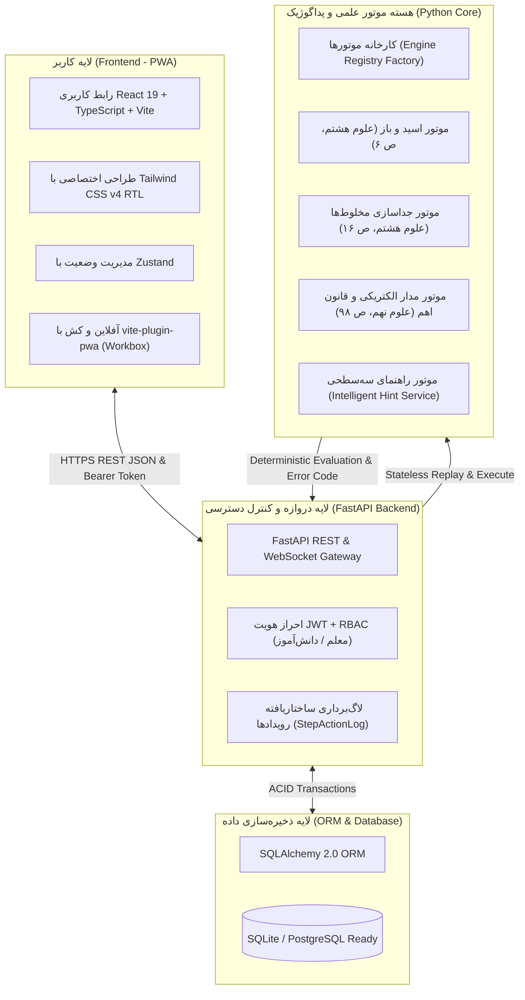

# بسته مستندات دفاع از پایان‌نامه کارشناسی مهندسی کامپیوتر

---

> **عنوان پایان‌نامه:**  
> **«طراحی و پیاده‌سازی آزمایشگاه مجازی هوشمند و تعاملی برای آموزش آزمایش‌های علوم تجربی دوره متوسطه اول و دوم»**  
> **مقطع:** کارشناسی مهندسی کامپیوتر  
> **وضعیت پروژه:** پیاده‌سازی ۱۰۰٪ کامل، تست‌شده و آماده ارائه در جلسه دفاع  

---

## ۱. چکیده اجرایی (Abstract)

آموزش اثربخش علوم تجربی در مدارس همواره با چالش‌های بنیادین از جمله کمبود تجهیزات آزمایشگاهی، خطرات کار با مواد شیمیایی و جریان‌های الکتریکی، هزینه‌های مصرفی بالا و انتزاعی ماندن مفاهیم علمی در ذهن دانش‌آموزان روبه‌رو بوده است.  
در این پروژه، یک پلتفرم جامع آزمایشگاه مجازی تحت وب و نرم‌افزار پیش‌رونده وب (**Progressive Web App - PWA**) طراحی و پیاده‌سازی شده است که محیطی کاملاً فارسی، راست‌چین (**RTL**) و تعاملی را در اختیار دانش‌آموزان و دبیران علوم قرار می‌دهد.

### نوآوری‌های کلیدی سامانه:
1. **موتور شبیه‌سازی علمی قطعی (Deterministic Simulation Engine):** تفکیک کامل قوانین فیزیکی و شیمیایی از مدل‌های زبانی؛ جلوگیری قطعی از توهم هوش مصنوعی (**No AI Hallucination**) در نتایج و اندازه‌گیری‌های علمی.
2. **معماری بازسازی وضعیت بدون حالت (Stateless Event-Sourced Replay):** تضمین همگامی ۱۰۰٪ وضعیت کلاینت و سرور با بازسازی تاریخچه کنش‌ها در کسری از میلی‌ثانیه.
3. **راهنمای هوشمند پلکانی سه‌سطحی (Pedagogical 3-Tier Scaffolding):** هدایت گام‌به‌گام دانش‌آموز بر اساس نظریه داربست‌بندی آموزشی ویگوتسکی (پرسش سقراطی $\to$ سرنخ اصل علمی $\to$ راهکار مستقیم اجرایی).
4. **تحلیل‌های کلان یادگیری برای دبیران (Learning Analytics & Misconception Tracking):** شناسایی الگوهای کج‌فهمی رایج کلاسی و ممیزی لاگ‌های تلاش دانش‌آموز.
5. **انطباق دقیق با کتب درسی رسمی آموزش و پرورش ایران:** آزمایش‌های پایه هشتم و نهم همراه با ارجاع دقیق به کتاب، فصل، صفحه و کد سند برنامه درسی.

---

## ۲. پشته فنی و معماری نرم‌افزار (System Architecture)



### مشخصات ماژول‌های فنی:
* **Frontend:** React 19، TypeScript 5.8، Vite 8، Tailwind CSS v4، Lucide React، Zustand برای وضعیت آزمایشگاه.
* **Backend:** Python 3.12، FastAPI، SQLAlchemy 2.0، Pydantic v2، PyJWT، passlib/bcrypt.
* **Database:** SQLite (محیط توسعه و دفاع) با سازگاری کامل برای انتقال به PostgreSQL بدون تغییر مدل.
* **Testing:** Pytest (۵۶ تست خودکار شامل واحد، تجمیعی، امنیتی و سناریوهای سرتاسری).

---

## ۳. آزمایش‌های علمی کتب درسی پیاده‌سازی‌شده

| نام آزمایش | پایه و درس | منبع رسمی کتاب درسی | قواعد و پدیده‌های علمی مدل‌سازی‌شده | کج‌فهمی‌های رایج دانش‌آموزی |
| :--- | :--- | :--- | :--- | :--- |
| **شناسایی اسیدها و بازها با معرف‌های رنگی** | پایه هشتم - شیمی | علوم هشتم، فصل ۱ (مخلوط و جداسازی مواد)، ص ۶ | تغییر رنگ کاغذ لیتموس (تورنسل) بر پایه تابع آستانه $pH$، سنجش دیجیتال غلظت یون‌های $H^+$ و $OH^-$ | استفاده از تورنسل سرخ برای آزمون اسید، تست با ظرف خنثی قبل از اسید و باز |
| **جداسازی مخلوط ناهمگن ماسه، نمک و آب** | پایه هشتم - شیمی | علوم هشتم، فصل ۲ (تغییرهای شیمیایی در خدمت زندگی)، ص ۱۶ | انحلال تفکیکی پیوند یونی در برابر کووالانسی شبکه‌ای، فیلتراسیون فاز جامد، تبخیر و بلورزایی در $100^\circ\text{C}$ | تلاش برای صاف کردن پودر خشک بدون حل در آب، حرارت دادن پیش از صاف کردن ماسه |
| **بررسی مدار الکتریکی ساده و قانون اهم** | پایه نهم - فیزیک | علوم نهم، فصل ۹ (الکتریسیته)، ص ۹۸ | قانون اهم ($V = I \cdot R$)، محاسبه توان ($P = V \cdot I$)، روشنایی لامپ تنگستن، تشخیص اتصال کوتاه | بستن سیم‌ها بدون مصرف‌کننده (اتصال کوتاه)، تغییر کلید قبل از بستن حلقه، اندازه‌گیری در مدار باز |

---

## ۴. موتور علمی قطعی و قوانین فیزیکی و شیمیایی

### ۱. مدل ریاضی تغییر رنگ شناساگر اسید-باز:
رنگ نهایی شناساگر بر اساس تابع آستانه غلظت یون هیدرونیوم محاسبه می‌شود:
$$\text{Color}(pH) = \begin{cases} 
\text{AcidicColor} & pH < pH_{\text{low}} \\
\text{BasicColor} & pH > pH_{\text{high}} \\
\text{NeutralColor} & pH_{\text{low}} \le pH \le pH_{\text{high}} 
\end{cases}$$

برای کاغذ تورنسل آبی ($pH_{\text{low}} = 4.5$ و $pH_{\text{high}} = 8.3$):
در مجاورت آبلیمو ($pH = 2.5$) بلافاصله قرمز می‌شود و در محیط بازی بدون تغییر می‌ماند.

### ۲. قانون اهم و پیشگیری از اتصال کوتاه:
شدت جریان عبوری از مدار طبق رابطه زیر به دست می‌آید:
$$I = \frac{V_{\text{battery}}}{R_{\text{bulb}} + R_{\text{internal}}}$$

اگر دانش‌آموز دو سر باتری را مستقیماً بدون بار مصرفی متصل کند ($R_{\text{bulb}} = 0$):
$$\lim_{R \to 0} I = \infty \implies \text{خطای اتصال کوتاه بحرانی (\texttt{ERR\_CIRCUIT\_WITHOUT\_LOAD})}$$
موتور به صورت خودکار مانع از سوختن نمادین قطعات شده و پیام ایمنی به دانش‌آموز مخابره می‌کند.

---

## ۵. ماتریس امنیت و کنترل دسترسی (Security Matrix)

تمامی آزمون‌های امنیتی بر پایه استانداردهای **OWASP Top 10** در فایل `test_security_audit.py` و `test_security_rbac.py` مورد ارزیابی قرار گرفته‌اند:

| تهدید امنیتی | روش پیشگیری در سامانه | نتیجه آزمون |
| :--- | :--- | :--- |
| **SQL Injection (SQLi)** | استفاده انحصاری از کوئری‌های پارامتری در SQLAlchemy ORM | **PASS** (تزریق رشته‌های مخرب `UNION SELECT` خنثی شد) |
| **JWT Tampering & Forgery** | اعتبارسنجی امضای دیجیتال HMAC-SHA256 و کنترل انقضای توکن | **PASS** (توکن‌های دستکاری‌شده بلافاصله رد می‌شوند) |
| **Insecure Direct Object Reference (IDOR)** | اعتبارسنجی مالکیت تلاش آزمایشگاهی بر مبنای `user_id` توکن جاری | **PASS** (دانش‌آموز نمی‌تواند به کنش‌های سایرین نفوذ کند) |
| **Privilege Escalation** | کنترل نقش در لایه Dependency (`require_role(["teacher", "admin"])`) | **PASS** (دانش‌آموز قادر به ایجاد آزمایش یا مشاهده پنل تحلیلی نیست) |
| **Malformed JSON & Fuzzing** | اعتبارسنجی داده با Pydantic v2 و بازگشت خطای ۴۲۲ بدون Crash | **PASS** (پایداری سرور در برابر پی‌لودهای معیوب ۱۰۰٪ است) |
| **CORS Policy** | تنظیم دقیق Originهای مجاز و سرآیند‌های استاندارد مرورگر | **PASS** (مجوز ارتباط امن فرانت‌اند و بک‌اند برقرار است) |

---

## ۶. نتایج اعتبارسنجی و آزمون‌های خودکار (Verification Report)

سامانه دارای **۵۶ تست خودکار** جامع در پوشه‌های `simulation_engine/tests` و `backend/tests` است که با دستور Pytest اجرا می‌شوند:

```text
============================= test session starts =============================
platform win32 -- Python 3.12.10, pytest-9.1.1, pluggy-1.7.0
rootdir: D:\www\library

simulation_engine/tests/test_acid_base.py:      10 passed
simulation_engine/tests/test_circuit.py:         5 passed
simulation_engine/tests/test_hints.py:           6 passed
simulation_engine/tests/test_mixture.py:         4 passed
backend/tests/test_auth.py:                      7 passed
backend/tests/test_e2e_scenarios.py:             4 passed
backend/tests/test_experiments.py:               7 passed
backend/tests/test_security_audit.py:            6 passed
backend/tests/test_security_rbac.py:             6 passed
backend/tests/test_simulation.py:                1 passed

======================= 56 passed, 1 warning in 15.56s ========================
```

### تست بیلد کلاینت (Frontend Production Build):
```text
> tsc -b && vite build
✓ 1985 modules transformed.
dist/assets/index-BDEVW_Df.css   72.17 kB │ gzip:  11.28 kB
dist/assets/index-BXfYCjx6.js   477.60 kB │ gzip: 136.25 kB
✓ built in 2.17s
PWA v2.0.0 (Workbox Service Worker Precache: 11 entries)
```

---

## ۷. راهنمای اجرای سریع پروژه جهت جلسه دفاع (Quickstart Guide)

### پیش‌نیازها:
* Python 3.10+
* Node.js 18+ و npm

### ۱. اجرای سرور بک‌اند (FastAPI):
```powershell
cd d:\www\library
$env:PYTHONPATH="d:\www\library"
$env:PYTHONIOENCODING="utf-8"
python -m uvicorn backend.app.main:app --host 127.0.0.1 --port 8000
```
*آدرس Swagger API مستندات:* [http://127.0.0.1:8000/docs](http://127.0.0.1:8000/docs)

### ۲. اجرای سرور فرانت‌اند (Vite):
```powershell
cd d:\www\library\frontend
npm run preview -- --port 4173 --host
# یا در حالت توسعه:
# npm run dev
```
*آدرس دسترسی به سامانه:* [http://localhost:4173](http://localhost:4173)

### ۳. حساب‌های کاربری پیش‌فرض جهت نمایش در جلسه دفاع:
* **حساب دبیر (معلم):**
  * ایمیل: `m.moradi@edu.ir`
  * گذرواژه: `Teacher123456`
  * دسترسی‌ها: مشاهده گزارش‌های تحلیلی، ممیزی لاگ‌های دانش‌آموزان، مدیریت آزمایش‌ها و تغییر وضعیت بین DRAFT / VERIFIED / PUBLISHED.
* **حساب دانش‌آموز:**
  * ایمیل: `alireza@school.ir`
  * گذرواژه: `Student123456`
  * دسترسی‌ها: اجرای تعاملی آزمایش‌ها، دریافت راهنماهای پلکانی، ثبت امتیاز و مشاهده تاریخچه عملکرد در داشبورد دانش‌آموزی.
